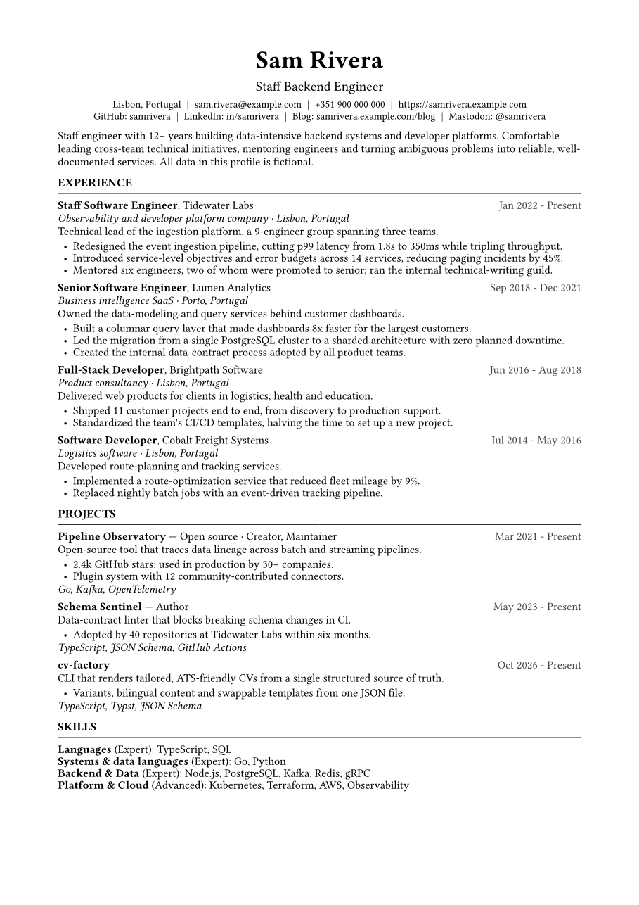
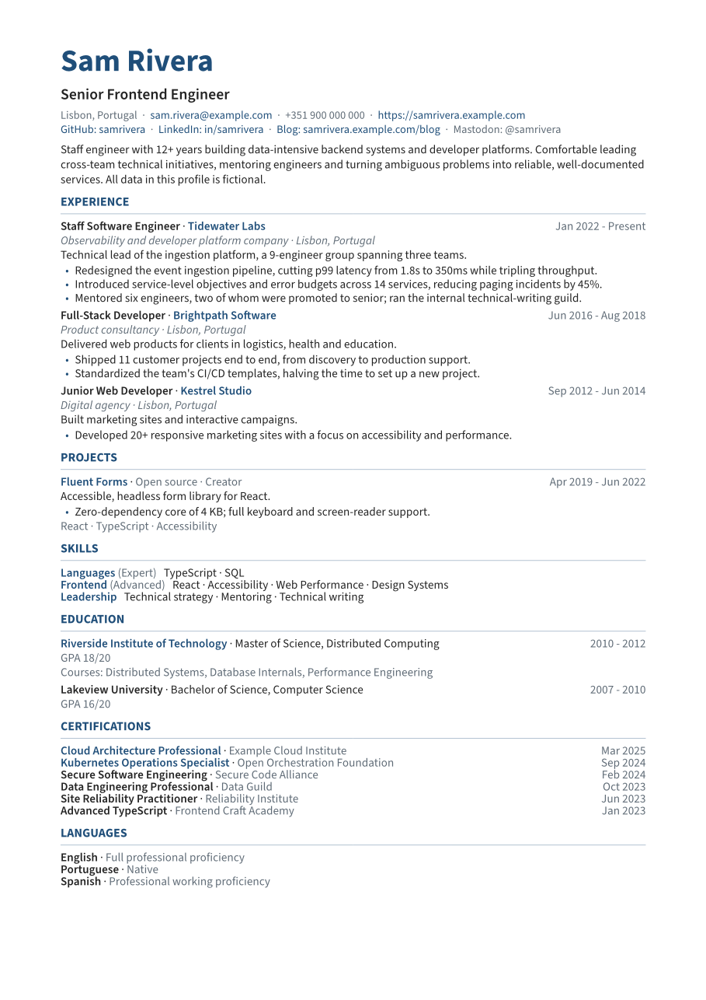
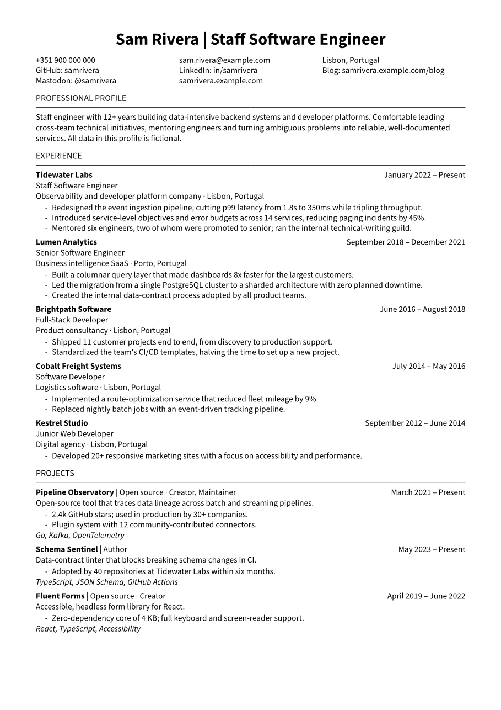
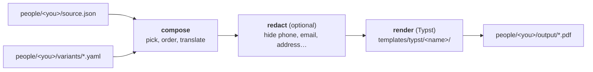

<div align="center">

# 🏭 CV Factory

**Your CV as structured data. Tailored, ATS-friendly PDFs on demand.**


[Quick start](#-quick-start) ·
[Gallery](#-gallery) ·
[Usage](#-usage) ·
[Scenarios](#-common-scenarios) ·
[Templates](#-templates) ·
[Privacy](#-privacy-and-your-own-data)

</div>

Write your career **once** in a single JSON file ([JSON Resume](https://jsonresume.org/schema)),
then generate as many CVs as you need: one per kind of role, in English or Spanish,
in the style you prefer, with or without your personal contact data.

## ✨ Features

- 🧬 **One source of truth** per person, in the standard JSON Resume format, validated against its schema.
- 🎯 **Variants**: different CVs for different roles from the same data (filter by tag, order sections, keep only the N most recent or featured items).
- 🌍 **Bilingual**: English (base) and Spanish, translated item by item, with warnings for what is missing.
- 🎨 **Templates**: three ATS-friendly styles, easy to add more.
- 🔒 **Shareable copies**: hide phone, email and address with one flag. The data is removed before the PDF exists.
- 👥 **Multiple people** in one repository; each person's data stays out of Git.
- ⚡ **One command for everything**: every variant × language × template.
- 🧩 **Swappable renderer**: a lightweight hexagonal architecture keeps Typst behind a port.

## 📸 Gallery

Real output from the fictional `showcase` person (click a preview to open its PDF):

<table>
  <tr>
    <td align="center" width="33%">
      <a href="people/showcase/output/showcase_backend_en_classic.pdf"></a><br>
      <b>classic</b> · backend
    </td>
    <td align="center" width="33%">
      <a href="people/showcase/output/showcase_frontend_en_modern.pdf"></a><br>
      <b>modern</b> · frontend
    </td>
    <td align="center" width="33%">
      <a href="people/showcase/output/showcase_full_en_clean.pdf"></a><br>
      <b>clean</b> · full
    </td>
  </tr>
</table>

All the generated PDFs are versioned in [`people/showcase/output/`](people/showcase/output/):

| Template · variant | English | Español |
|---|---|---|
| **classic** · backend | [PDF](people/showcase/output/showcase_backend_en_classic.pdf) | [PDF](people/showcase/output/showcase_backend_es_classic.pdf) |
| **modern** · frontend | [PDF](people/showcase/output/showcase_frontend_en_modern.pdf) | [PDF](people/showcase/output/showcase_frontend_es_modern.pdf) |
| **classic** · full (everything) | [PDF](people/showcase/output/showcase_full_en_classic.pdf) | [PDF](people/showcase/output/showcase_full_es_classic.pdf) |
| **modern** · full | [PDF](people/showcase/output/showcase_full_en_modern.pdf) | |
| **clean** · full | [PDF](people/showcase/output/showcase_full_en_clean.pdf) | |
| 🔒 **shareable** (`--public`) · backend | [PDF](people/showcase/output/showcase_backend_en_classic_redacted.pdf) | |

Compare `backend` and `frontend` to see how one source produces different CVs.

## 🚀 Quick start

**1. Install the tools**

| Tool | Install |
|---|---|
| Node.js ≥ 22 | <https://nodejs.org> · check with `node --version` |
| Typst (PDF engine) | Windows: `winget install --id Typst.Typst`, then **open a new terminal** · macOS: `brew install typst` |

<details>
<summary>More ways to install Typst, and how to verify it</summary>

cv-factory calls the official [`typst`](https://github.com/typst/typst) binary.

- Download an archive from the [GitHub Releases](https://github.com/typst/typst/releases) and put `typst` on your `PATH` (package managers can lag behind).
- Any platform with Rust: `cargo install --locked typst-cli`.
- Verify with `typst --version` (developed against 0.15.1). Update with `winget upgrade Typst.Typst`, or `typst update` for a release archive.
- If `typst` is not on your `PATH` (e.g. a terminal opened before installing), set `CV_FACTORY_TYPST` to the executable.

</details>

**2. Install the project**
```bash
npm install
npm test            # optional sanity check
```

**3. Render your first CV**
```bash
npm run dev -- render backend --person showcase --no-date
# → people/showcase/output/showcase_backend_en_classic.pdf
```
Only the variant and the person are needed: language (`en`), template (`classic`) and everything else take their defaults. `--no-date` gives a stable file name; without it the name ends in today's date. Spanish, other templates, hidden data and more are options you add when you need them: see [Usage](#-usage).

Then make it yours: [create your own person](#-privacy-and-your-own-data), or let an AI assistant [build it from your existing CV](#-use-it-with-an-ai-assistant).

## 🤖 Use it with an AI assistant

The repository includes step-by-step playbooks for an AI model (any model that can read files and run commands), in [docs/agent/](docs/agent/README.md):

- **You already have a CV (PDF):** give it to your assistant and point it at [`from-pdf.md`](docs/agent/from-pdf.md). It builds your `source.json` and variants, validates, renders and iterates with you.
- **You are starting from nothing:** [`from-scratch.md`](docs/agent/from-scratch.md) runs a question-and-answer interview until there is a solid base that renders.
- **You want it polished:** [`review.md`](docs/agent/review.md) is a checklist for wording, skills, translations and privacy.

A prompt as simple as *"Read docs/agent/README.md and build my CV from this PDF"* is enough. Your data stays in `people/<you>/`, which is git-ignored.

## 🧠 How it works



| Concept | Meaning | Lives in |
|---|---|---|
| 👤 **Person** | Owner of a CV | `people/<slug>/` |
| 🧬 **Source of truth** | All of a person's information, in English | `people/<slug>/source.json` |
| 🎯 **Variant** | What to show for a kind of role | `people/<slug>/variants/<name>.yaml` |
| 🌍 **Language** | `en` (base) or `es` | `--lang`, `x-cv-factory.i18n` |
| 🎨 **Template** | How the PDF looks | `templates/typst/<name>/` |

A PDF is the combination of all of them, written to:

```
people/<person>/output/<person>_<variant>_<lang>_<template>[_redacted]_<YYYY-MM-DD>.pdf
people/showcase/output/showcase_backend_es_classic_2026-10-19.pdf
```

- Every dimension is in the name, so different combinations never overwrite each other.
- The date is **today's local date**: it works as a version. Another day creates a new file; the same day replaces that day's.
- The tool never deletes old files; clean `people/<person>/output/` yourself.
- `--no-date` leaves the date out for a stable name (the versioned samples use it).
- Versions with data hidden carry `_redacted`, so they never replace the full CV.

## 📖 Usage

The command is **`cvf`** (`cv-factory` works as an alias). Without installing anything, use `npm run dev -- <command>` in the project folder; to get a real `cvf` command in your terminal, build and link it once:
```bash
npm run build && npm link      # then `cvf <command>` works from any folder
```
Examples below use `cvf`.

| Command | What it does |
|---|---|
| `list-people` | List the people available. |
| `list-variants` | List a person's variants. |
| `validate` | Validate `source.json` and all variants. |
| `compose <variant>` | Print the resolved `resume.json` (to stdout, or `-o <file>`). |
| `render <variant>` | Compose and render one PDF. |
| `render-all` | Render every variant × language × template. |

| Option | Applies to | Meaning |
|---|---|---|
| `-p, --person <slug>` | all | Person to use. Optional only when there is exactly one. |
| `-l, --lang <en\|es>` | compose, render | Language (default: the variant's, else `en`). |
| `-t, --template <name>` | render | Template (default: the variant's, else `classic`). |
| `--no-date` | render, render-all | Leave the date out of the file name. |
| `--public` | compose, render, render-all | Shareable preset: hides phone, email, address and photo. |
| `--hide <list>` | compose, render, render-all | Hide specific data: `phone`, `email`, `address`, `location`, `website`, `profiles`, `image` (details under [Common scenarios](#-common-scenarios) → *Shareable version*). |
| `--variants`, `--langs`, `--templates <list>` | render-all | Comma-separated subsets (each defaults to all). |

The minimum is the variant (plus `--person` if there is more than one person); add options only when you need them:

| You want… | Add | Example |
|---|---|---|
| Spanish (or English when the variant defaults to Spanish) | `--lang es` | `cvf render backend --person showcase --lang es` |
| Another look | `--template modern` | `cvf render backend --person showcase --template modern` |
| A stable file name, without the date | `--no-date` | `cvf render backend --person showcase --no-date` |
| A copy without phone, email, address or photo | `--public` | `cvf render backend --person showcase --public` |
| Hide only some data | `--hide phone,email` | `cvf render backend --person showcase --hide phone` |
| Every variant, language and template | `render-all` | `cvf render-all --person showcase --langs es` |
| See the data a template receives | `compose` | `cvf compose backend --person showcase --lang es` |

Options combine: `cvf render backend --person showcase --lang es --template modern --public --no-date`.

Missing translations are printed as warnings on stderr and fall back to English.
Step-by-step guides (adding a job, creating a variant, translating, versioning) are in
[docs/workflow.md](docs/workflow.md).

## 🎯 Common scenarios

<details>
<summary><b>⚡ Generate every version in one command</b></summary>

`render-all` renders every **variant × language × template** of a person:
```bash
cvf render-all --person your-name
# 2 variants × 2 languages × 3 templates = 12 PDFs in people/your-name/output/
cvf render-all --person showcase --variants backend,full --langs es --templates clean,modern
cvf render-all --person showcase --no-date          # stable file names
```
- Data is validated once, up front; invalid data stops the run before anything is rendered.
- An unknown variant, language or template is rejected with the list of valid ones.
- If one combination fails, the others still render. The summary says how many succeeded and failed, identical errors (e.g. `typst` not installed) are printed once with the combinations they affect, and the exit code is 1.
- Translation warnings are printed per combination (`variant/lang/template`).
- Templates are discovered from `templates/typst/` (every folder with a `main.typ`), so a new template is included automatically.

</details>

<details>
<summary><b>🔒 Shareable version: hide sensitive data</b></summary>

Generate a copy without personal data to post publicly or send around, leaving the full CV untouched:
```bash
cvf render backend --person your-name --public          # preset
cvf render backend --person your-name --hide phone      # just the phone
cvf render-all --person your-name --public --hide location
```
- **`--public`** hides `phone`, `email`, `address` and `image`. City, website and profiles stay, so there is still a way to reach you.
- **`--hide <list>`** hides specific data: `phone`, `email`, `address` (street and postal code; city and country stay), `location` (all of it), `website`, `profiles`, `image`. It adds to `--public` if you use both.
- The data is removed **before the PDF is generated**, so it is not in the file at all (no hidden text under a white box). If nothing is left to contact the person you get a warning.

What to treat as sensitive:

| Data | Share publicly? | Why |
|---|---|---|
| 📞 Phone | ❌ No | Spam, phone scams, WhatsApp impersonation. |
| ✉️ Email | ⚠️ Depends | Scraped for spam and phishing. Hide it in open posts; keep it when sending directly to a recruiter. |
| 🏠 Street address, postal code | ❌ Never | City and country are enough. |
| 🪪 Photo, date of birth, national ID, marital status, nationality | ❌ Do not include | Useful for identity fraud, and not needed to be hired. |
| 🌐 Website, GitHub, LinkedIn | ✅ Yes | They are your public way to be contacted. |
| 👥 References with contact details | ❌ No | They are other people's data. |
| 🏢 Employer-internal details (user counts, internal systems or project names) | 🔍 **Review by hand** | May be covered by a confidentiality agreement. The tool cannot detect it: it is free text in `summary` and `highlights`. |

</details>

<details>
<summary><b>🏅 Keep every certification in the source, show only some</b></summary>

Put all of them in `source.json`. Each variant decides what to show, with three independent options you can combine per section:

| Option | What it does |
|---|---|
| `sort` | Orders a section by a field. Default is descending (most recent first); items without the field go last. |
| `require` | Strict tag filter: keeps only items carrying one of the listed tags. Untagged items are dropped. |
| `limits` | Keeps the first N items, after filtering and sorting. |

**The 6 most recent certifications**
```yaml
sort:
  certificates: { by: date }
limits:
  certificates: 6
```

**The 6 featured certifications, most recent first.** Tag the ones you want to highlight in `source.json` (`"x-cv-factory": { "tags": ["featured"] }`), then:
```yaml
require:
  certificates: [featured]
sort:
  certificates: { by: date }
limits:
  certificates: 6
```
If fewer than 6 are tagged, you simply get fewer. Different variants can feature different items by using different tags.

**Mixing with the global tag filter.** `filter.tags` applies to *every* section by default, and `require` is applied on top of it, so a variant that filters by `backend` would also drop featured certifications that are not tagged `backend`. Scope the global filter to the sections that need it:
```yaml
filter:
  tags: [backend, platform]
  sections: [work, projects, skills]   # certificates are left to `require`
```
See `people/showcase/variants/backend.yaml` (featured) and `frontend.yaml` (most recent).

</details>

<details>
<summary><b>🧱 Skills grouped by category, and variant-specific skills</b></summary>

Grouping comes from the JSON Resume specification, not from the templates. `skills` is a list of groups; each has a `name` (the category), an optional `level` and its `keywords` (the items):
```json
{ "name": "Database", "keywords": ["PostgreSQL", "SQL Server", "MySQL"] }
```
Templates only print the name followed by its keywords. What this tool adds is that **tags, translations and limits apply to the whole group**, not to single keywords, so a variant decides which *categories* appear.

To show some keywords only in some variants, split a group in two: keep the common ones in an untagged group (shown everywhere) and move the rest into their own tagged group.
```json
{ "name": "Languages", "keywords": ["TypeScript", "SQL"] },
{ "name": "Systems & data languages", "keywords": ["Go", "Python"],
  "x-cv-factory": { "tags": ["backend", "data"] } }
```
With `filter: { tags: [frontend] }` the second group disappears; with `filter: { tags: [backend] }` both are shown. Compare `showcase_frontend_*` with `showcase_backend_*`.

</details>

<details>
<summary><b>🎯 Another role, same data</b></summary>

Create `people/<slug>/variants/<name>.yaml`, tag your items in `source.json`, and filter by those tags. See [docs/workflow.md](docs/workflow.md#3-create-a-variant-for-a-kind-of-role).

</details>

<details>
<summary><b>🌍 A different language for one variant</b></summary>

Add `x-cv-factory.i18n.es` to the items you want translated and render with `--lang es`. Fields you leave out fall back to English with a warning; see [docs/data-schema.md](docs/data-schema.md#rules-for-i18n).

</details>

## 🎨 Templates

| Template | Look |
|---|---|
| `classic` (default) | Serif, black on white, centered header. |
| `modern` | Sans-serif (bundled Source Sans 3), one accent color, left-aligned header. |
| `clean` | Sans-serif, black ink, centered `Name \| Role` header with contact in three columns, full month names, hyphen bullets. Groups consecutive roles at the same employer under one heading. |

All are single-column, plain text in reading order, with no icons, images or tables, so ATS parsers can extract them cleanly. Pick one per run with `--template`, or per variant with `template:` in the variant file. All render `work`, `volunteer`, `projects`, `education`, `skills`, `certificates`, `awards`, `publications`, `languages` and `interests`.

**Several roles at one employer.** Write one `work` entry per role, with the same `name` and consecutive in the file. `clean` shows the employer once with the overall date range and lists the roles under it; `classic` and `modern` repeat the employer on each role.

## 🔐 Privacy and your own data

Real people live in `people/<slug>/` and are **git-ignored**, so personal data is never committed. Only the fictional `example` (minimal) and `showcase` (complete) are versioned. Generated PDFs are written to `people/<you>/output/`, inside the same git-ignored folder; only `people/showcase/output/` is versioned.

```bash
cp -r people/example people/your-name     # or start from showcase to see every option
cvf validate --person your-name
cvf render-all --person your-name
```
Slugs use lowercase letters, digits and hyphens only. To keep your own data under version control, make `people/<slug>/` its own **private** Git repository (see [docs/workflow.md](docs/workflow.md#5-version-with-git)).

After changing a template, the data of `showcase` or the render logic, regenerate the versioned samples (rendered with `--no-date`) with:
```bash
npm run samples
```

## 📁 Project structure

```
people/
  example/  showcase/        fictional people (versioned)
  <you>/                     your data (git-ignored)
templates/typst/
  _shared/                   helpers, labels and fonts used by every template
  classic/  modern/  clean/  one folder per template
schema/                      JSON Resume + variant + extension schemas
src/                         domain · ports · adapters · app · cli
test/                        Vitest
docs/                        architecture, data schema, workflow
docs/agent/                  playbooks for an AI assistant (from a PDF, from scratch, review)
```

## 📚 Documentation

| | |
|---|---|
| [AGENTS.md](AGENTS.md) | Project rules and conventions |
| [docs/architecture.md](docs/architecture.md) | Layers, renderer contract, templates |
| [docs/data-schema.md](docs/data-schema.md) | Fields used, `x-cv-factory` extensions, variant format |
| [docs/workflow.md](docs/workflow.md) | Step-by-step guides |
| [docs/agent/](docs/agent/README.md) | Playbooks for an AI assistant: build a CV from a PDF or from scratch, and review it |

## 📄 Licenses

The code is released under the [MIT License](LICENSE).

The `modern` and `clean` templates use **Source Sans 3** (Adobe), bundled in
`templates/typst/_shared/fonts/` under the SIL Open Font License 1.1; the license
is in that folder. It applies to the font files only.
